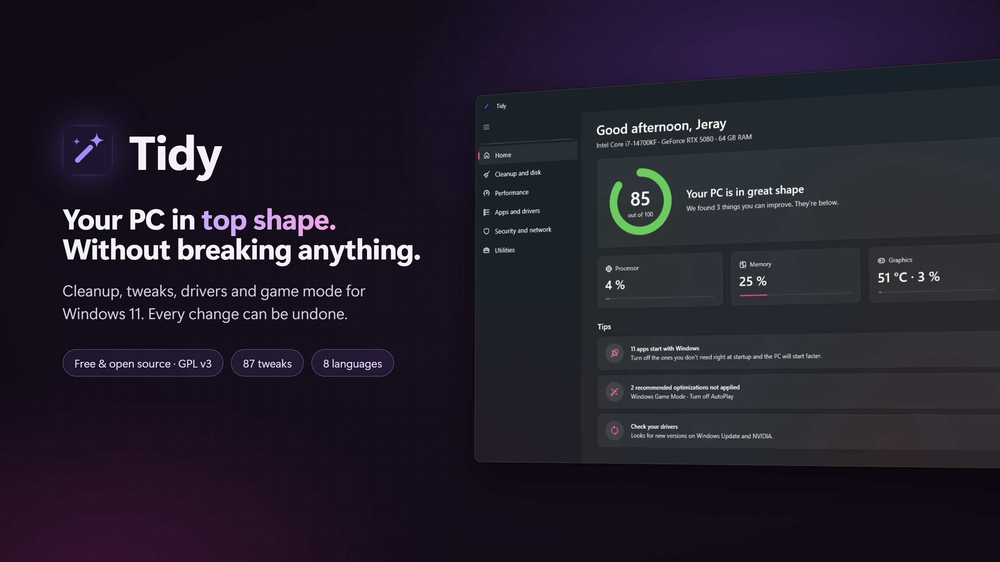
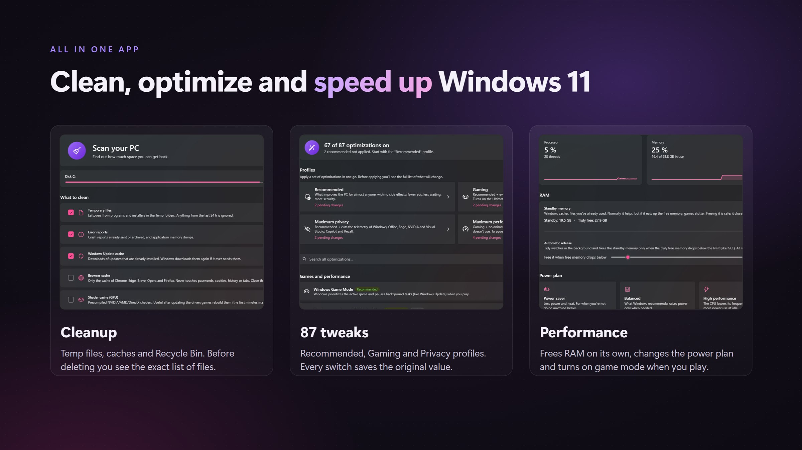
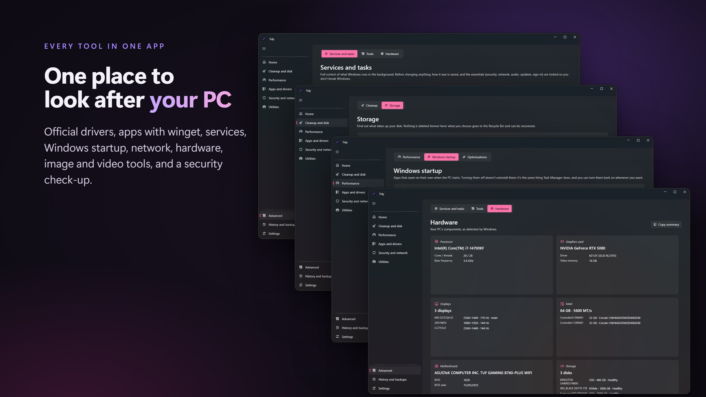
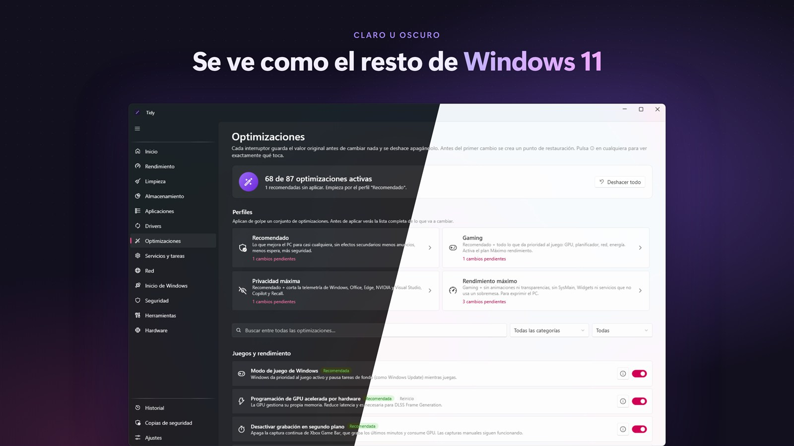
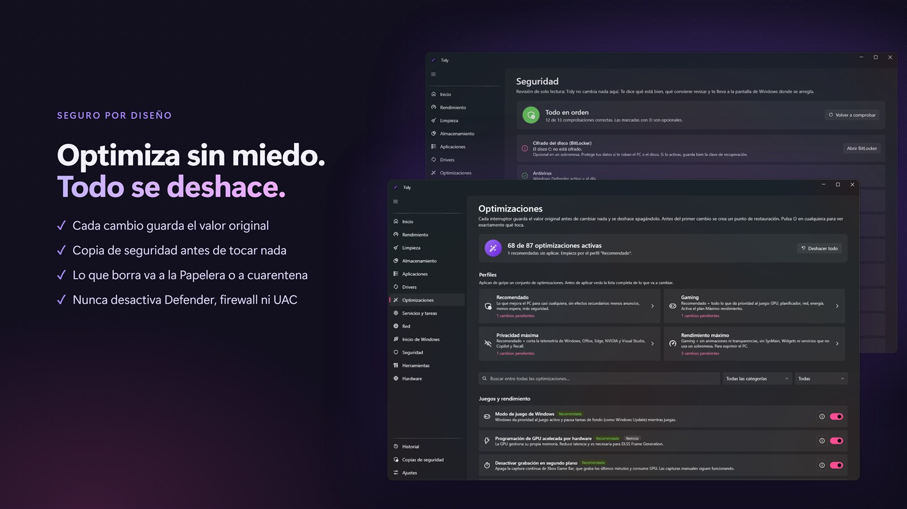

# Tidy

[English](README.md) · **Español**

**Haz Windows 11 más rápido, más limpio y más privado, sin romper nada.** Tidy te enseña exactamente qué va a cambiar antes de hacerlo, y cualquier cambio se deshace con un clic.



**[Descarga la última versión](../../releases/latest)** · Libre y de código abierto · En español, inglés, portugués, francés, alemán, ruso, chino y japonés · Únete al [Discord](https://discord.gg/34RZad5Uas)

## Por qué Tidy

- **Todo se deshace.** Tidy guarda copia de cada valor que cambia. Cualquier optimización, servicio, app de inicio o cambio de DNS vuelve atrás con un clic desde Historial.
- **Nada a tus espaldas.** Antes de borrar ves la lista exacta de archivos, y lo que quitas desde Almacenamiento va a la Papelera.
- **Nunca baja tu seguridad.** Ninguna "optimización" desactiva Defender, el firewall, el UAC, SmartScreen ni Windows Update.
- **Gratis, sin anuncios, sin cuentas y sin telemetría.** Tidy solo se conecta a internet para lo que tú le pides y para buscar actualizaciones en GitHub (puedes desactivarlo).

## Qué hace

**Empieza con un clic.** Tidy revisa tu PC (memoria, archivos innecesarios, arranque y drivers), te dice qué merece la pena mejorar, y "Optimizar ahora" libera RAM y te enseña qué limpiar. Déjalo en la bandeja y cuida tu PC solo, gastando muy pocos recursos.

### Un PC más rápido
- **87 optimizaciones reversibles** con perfiles: Recomendado, Gaming, Privacidad y Rendimiento máximo. Cada una explica qué hace.
- **Inicio de Windows:** mira qué apps retrasan tu arranque según Windows y cuántos segundos, quítalas y compara el tiempo de arranque antes y después de Tidy.
- **Memoria:** libera la RAM en espera solo cuando empieza a faltar.
- **Segundo plano:** mide lo que gastan los programas abiertos sin ventana y te deja cerrarlos o quitarlos del inicio.
- **Planes de energía,** y cuándo se apaga la pantalla y cuándo se suspende o hiberna el PC.
- **Servicios y tareas programadas** que están activos sin hacer falta (telemetría, informes de errores, funciones que casi nadie usa), con el porqué de cada uno.

### Más espacio libre
- **Limpieza:** temporales, cachés, restos de Windows Update, cachés de navegadores y de shaders de la GPU, y la Papelera.
- **Análisis de disco:** qué carpetas y archivos ocupan más, con filtros por tipo y tamaño.
- **Descargas y duplicados,** y **mover a otro disco** para liberar C: (y devolverlo todo a su sitio desde Historial).
- **Limpieza programada:** Tidy te avisa o limpia solo, únicamente las categorías que elijas.

### Juegos
- **Modo juego automático:** al abrir un juego, Tidy pasa al plan de máximo rendimiento, libera RAM y le da prioridad al juego. Al cerrarlo, todo vuelve a como estaba.

### Privacidad y red
- **Bloquea anuncios, rastreadores y malware en todo el PC** con el archivo hosts, y protégelo para que nada más pueda cambiarlo.
- **Cambia el DNS** y mide cuál es más rápido, mide la latencia y repara la conexión.

### Aplicaciones y drivers
- **Desinstalador en profundidad:** quita el programa y sus restos, que van a una cuarentena recuperable.
- **Actualiza o instala apps** con winget, desde un catálogo.
- **Drivers** desde Windows Update y nvidia.com, comprobando su firma digital.

### Arreglar problemas
- **Reparar Windows** con sus propias herramientas, y revisar la **salud de tus discos**.
- **"¿Quién está usando este archivo?"** para cuando Windows no te deja borrar o mover algo.
- **Revisión de seguridad** (solo lectura): antivirus, firewall, UAC, Secure Boot, TPM…
- **Hardware:** los componentes de tu PC de un vistazo.

### Utilidades
- **Imágenes:** convierte entre JPG, PNG, BMP, TIFF, GIF e ICO (también abre HEIC, WebP y AVIF), comprime, reduce el tamaño y quita datos ocultos como el GPS.
- **Vídeo y audio:** comprime vídeos a MP4 o saca solo el sonido en MP3 o M4A.
- **Comprobar una descarga:** compara su huella (SHA-256 y otras) con la de la web y mira si el programa lleva una firma digital válida.
- Los originales no se tocan: cada resultado es una copia nueva.

### Siempre bajo control
- **Historial** de todo lo que hace Tidy, con deshacer.
- **Punto de restauración** antes de cambiar el sistema.
- **Exporta tu configuración** y llévate tus optimizaciones a otro PC.
- **Mini app en la bandeja** con resumen, rendimiento y limpieza, tema claro y oscuro, y actualizaciones desde la propia app comprobando la huella SHA-256.







## Lo que Tidy no hace a propósito

No desactiva Defender, el firewall, el UAC, SmartScreen, Windows Update ni las protecciones contra Spectre/Meltdown. Muchos "optimizadores" lo hacen, y es la forma clásica de dejar un PC expuesto.



## Descarga

- **Tidy-Setup.exe** instala Tidy en Archivos de programa, con acceso en el menú Inicio y desinstalación desde Configuración > Aplicaciones. Se actualiza solo desde la app.
- **Tidy-Portable.exe** funciona sin instalar. Guarda todo en una carpeta `TidyData` junto al .exe y no deja nada más en el PC.

Requiere Windows 11 (64 bits) y el [.NET 10 Desktop Runtime](https://dotnet.microsoft.com/download/dotnet/10.0).

### "Windows protegió su PC"

Tidy aún no está firmado con un certificado de pago, así que Windows lo muestra como "Editor desconocido". Para abrirlo: **Más información** → **Ejecutar de todas formas**. Para comprobar que tu descarga es la auténtica, compara su SHA-256 con el archivo `.sha256` de la página de la versión:

```
certutil -hashfile Tidy-Setup.exe SHA256
```

## Compilar

```
dotnet publish src/Tidy -c Release -p:PublishSingleFile=true -p:DebugType=none -o dist
```

Pruebas de seguridad (se ejecutan en una carpeta aislada):

```
dotnet run --project tests/Tidy.Tests
```

Publicar una versión (sube `<Version>` en `src/Tidy/Tidy.csproj`, añade su entrada a `CHANGELOG.md` y haz commit antes):

```
python tools/release.py 1.2.1
```

Compila, crea Tidy-Setup.exe, Tidy-Portable.exe y su `.sha256`, publica la release con las notas en inglés y en español, y comprueba en GitHub que no tienen acentos rotos y que la huella coincide.

## Licencia

Tidy es software libre bajo la [GNU GPL v3](LICENSE): puedes usarlo, estudiarlo, modificarlo y compartirlo, y cualquier versión modificada que se publique tiene que seguir siendo libre y con su código. Se ofrece sin ninguna garantía.

Copyright © 2026 Jeray665 · [Privacidad](PRIVACY.md#privacidad) · [Avisos de terceros](THIRD-PARTY-NOTICES.md) · [Seguridad](SECURITY.md)
